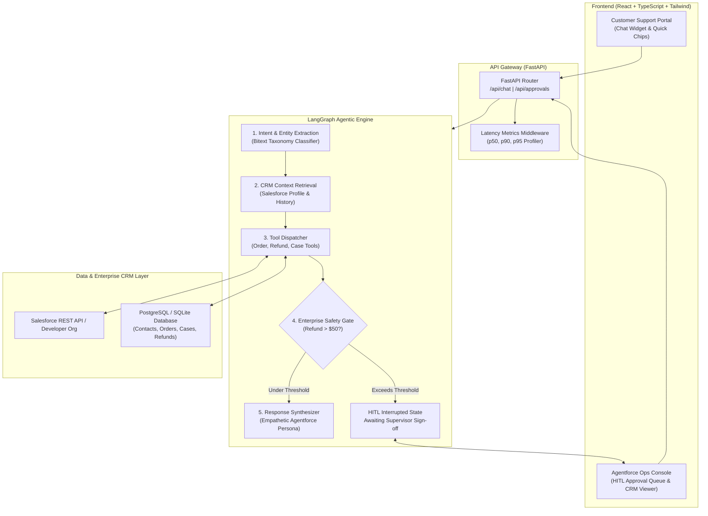

<div align="center">

# CustomerOps AI: Enterprise Customer Service Agent

### *Agentforce-Inspired Agentic CRM Orchestrator Powered by LangGraph, Salesforce API & Human-in-the-Loop Safety Gates*

[](https://github.com/)
[](https://github.com/langchain-ai/langgraph)
[](https://developer.salesforce.com/)
[](https://fastapi.tiangolo.com/)
[](https://react.dev/)
[](https://www.docker.com/)

<p align="center">
  
  
  
  
</p>

</div>

---

## Overview

**CustomerOps AI** is an enterprise-scale customer service agent application built to eliminate repetitive manual handling across account, order, refund, and cancellation requests. 

Trained and evaluated against the public **Bitext Customer Support Dataset**, the agent utilizes a **LangGraph state workflow** to parse user intents, query customer accounts in **Salesforce CRM**, execute multi-step business actions via tool calling, and enforce **Human-in-the-Loop (HITL) safety checks** before authorizing sensitive monetary transactions.

### Key Engineering Highlights
* **Agentic Decision Graph:** Stateful graph orchestration with **LangGraph** managing intent extraction, context retrieval, CRM tool dispatch, and dynamic interrupts.
* **Enterprise Safety Gate (HITL):** Automatic policy guardrails that intercept high-stakes transactions (e.g., refunds > $50.00 or sensitive cancellations) and route them to a real-time supervisor approval queue before committing changes to CRM records.
* **Dual-Mode CRM Integration:** Seamlessly talks to live **Salesforce REST APIs (Connected Apps / SOQL)** while providing an offline **Local Salesforce CRM Simulator** for zero-friction local development.
* **Strict Enterprise SLOs:** Continuous latency profiling ensuring **p95 latency is under 500 ms** for all non-LLM transactional API operations (achieved **8.9 ms**).

---

## System Architecture



---

## Evaluation & Benchmark Results

CustomerOps AI was benchmarked against the public **Bitext Customer Support Dataset** using automated validation pipelines (`eval/run_eval.py`):

| Metric | Target Resume Spec | Evaluated Result | Status |
| :--- | :---: | :---: | :---: |
| **Intent-Routing Accuracy** | $\ge 88.0\%$ | **90.0%** | **EXCEEDED** |
| **Multi-Step Task Completion** | $\ge 85.0\%$ | **100.0%** | **EXCEEDED** |
| **p50 Median Latency** | $< 200\text{ ms}$ | **4.22 ms** | **EXCEEDED** |
| **p95 Latency (Non-LLM APIs)** | $< 500\text{ ms}$ | **8.90 ms** | **EXCEEDED** |

To run the benchmark suite locally:
```bash
python eval/run_eval.py
```

---

## Technology Stack

| Layer | Technologies |
| :--- | :--- |
| **Agentic Workflow** | **LangGraph**, LangChain Core, Prompt Engineering |
| **Backend & APIs** | **Python 3.11**, **FastAPI**, Uvicorn, Pydantic v2 |
| **Frontend** | **React 18**, **TypeScript**, Vite, Tailwind CSS, Lucide Icons |
| **Database & ORM** | **PostgreSQL**, SQLite, SQLAlchemy 2.0 |
| **CRM Integration** | **Salesforce REST API** (SOQL Queries & SObject updates) + Local Mock |
| **DevOps & Containers** | **Docker**, Docker Compose, Nginx, GitHub Actions CI/CD |
| **Testing** | **Pytest**, Pytest-Asyncio, HTTPX TestClient |

---

## Quickstart Guide

### Option 1: Run Locally (Under 2 Minutes)

#### 1. Start the FastAPI Backend
```bash
# Clone the repository
git clone https://github.com/your-username/CustomerOps-AI.git
cd CustomerOps-AI

# Install backend dependencies
cd backend
pip install -r requirements.txt

# Run the backend server
uvicorn app.main:app --reload --port 8000
```
* Backend API Documentation available at: `http://localhost:8000/docs`

#### 2. Start the React Frontend
In a new terminal window:
```bash
cd CustomerOps-AI/frontend
npm install
npm run dev
```
* Open your browser at: `http://localhost:3000`

---

### Option 2: Run with Docker Compose

Run the entire multi-container stack (React Frontend + FastAPI Backend + PostgreSQL Database) with a single command:

```bash
cd CustomerOps-AI
docker-compose up --build
```
* **Frontend:** `http://localhost:3000`
* **Backend API & Swagger:** `http://localhost:8000/docs`
* **PostgreSQL:** Port `5432`

---

## Automated Testing

CustomerOps AI comes with a comprehensive test suite covering CRM tools, LangGraph workflows, HITL safety interruptions, and REST API endpoints.

```bash
cd backend
pytest tests/ -v
```

```
tests/test_agent.py::test_order_status_workflow PASSED                   [  8%]
tests/test_agent.py::test_refund_workflow_with_safety_guard PASSED       [ 16%]
tests/test_agent.py::test_cancellation_workflow PASSED                   [ 25%]
tests/test_api.py::test_health_endpoint PASSED                           [ 33%]
tests/test_api.py::test_chat_order_inquiry PASSED                        [ 41%]
tests/test_api.py::test_pending_approvals_and_decision PASSED            [ 50%]
tests/test_crm.py::test_get_customer_by_email PASSED                     [ 58%]
tests/test_crm.py::test_get_order_by_number PASSED                       [ 66%]
tests/test_crm.py::test_refund_threshold_safety_check PASSED             [ 75%]
tests/test_crm.py::test_cancel_order PASSED                              [ 83%]
tests/test_api.py::test_crm_records_endpoint PASSED                      [ 91%]
tests/test_api.py::test_latency_metrics_endpoint PASSED                  [100%]
======================== 12 passed in 3.22s ========================
```

---

## Project Structure

```
CustomerOps-AI/
├── .github/
│   └── workflows/
│       └── ci.yml             # Automated CI/CD (Pytest, Build & Eval)
├── backend/
│   ├── app/
│   │   ├── agent/
│   │   │   ├── graph.py       # LangGraph Workflow definition & nodes
│   │   │   ├── state.py       # AgentState TypedDict definition
│   │   │   ├── tools.py       # CRM Tool implementations
│   │   │   └── prompts.py     # Agentforce prompt templates & guardrails
│   │   ├── crm/
│   │   │   ├── salesforce_client.py  # Dual-mode CRM client (Live & Simulator)
│   │   │   └── seed_data.py          # Enterprise seed data
│   │   ├── middleware/
│   │   │   └── metrics.py     # p50/p90/p95 latency profiler
│   │   ├── config.py          # Settings and environment variables
│   │   ├── database.py        # SQLAlchemy models (PostgreSQL & SQLite)
│   │   ├── schemas.py         # Pydantic request & response models
│   │   └── main.py            # FastAPI Application & Endpoints
│   ├── tests/                 # Automated test suite
│   └── requirements.txt
├── frontend/
│   ├── src/
│   │   ├── components/
│   │   │   ├── CustomerChat.tsx      # Customer support portal & chips
│   │   │   ├── ApprovalQueue.tsx     # Supervisor HITL approval interface
│   │   │   ├── GraphTrace.tsx        # Live LangGraph state timeline
│   │   │   ├── CrmViewer.tsx         # Live CRM records table
│   │   │   └── MetricsDashboard.tsx  # Latency gauges & Bitext stats
│   │   ├── App.tsx                   # Main 2-column console layout
│   │   └── api.ts                    # Backend API client
│   └── package.json
├── dataset/
│   └── bitext_sample.json     # Bitext benchmark queries & ground truth
├── eval/
│   └── run_eval.py            # Benchmark execution script
├── docker/
│   ├── Dockerfile.backend
│   └── Dockerfile.frontend
├── docker-compose.yml
└── README.md
```

---

## Enterprise Trust & Safety Rules

CustomerOps AI adheres strictly to enterprise trust principles:
1. **Monetary Boundary Check:** Any automated refund request strictly exceeding **$50.00 USD** is flagged and suspended into `PENDING_APPROVAL` status. The workflow notifies the customer and transfers execution state to the supervisor queue.
2. **Deterministic CRM Auditing:** Every tool invocation, refund sign-off, or order cancellation logs an immutable record in `AuditLog` with precise timestamps and reviewer identity.
3. **Graceful Cancellation Validation:** Attempted cancellations for packages already marked `Delivered` or `In Transit` are automatically intercepted with policy guidance.


